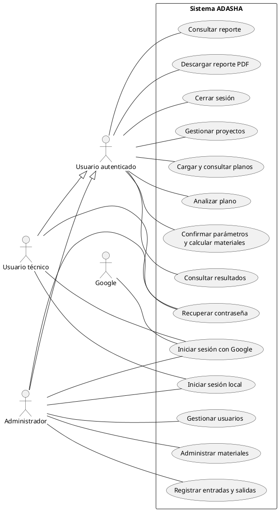
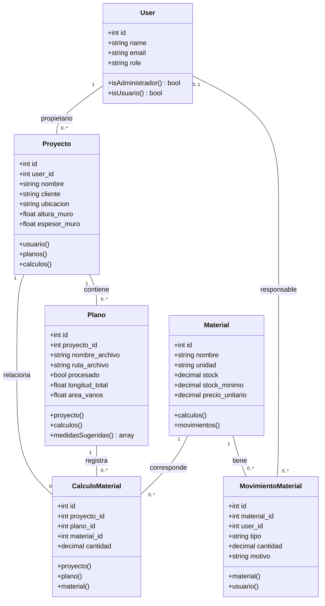
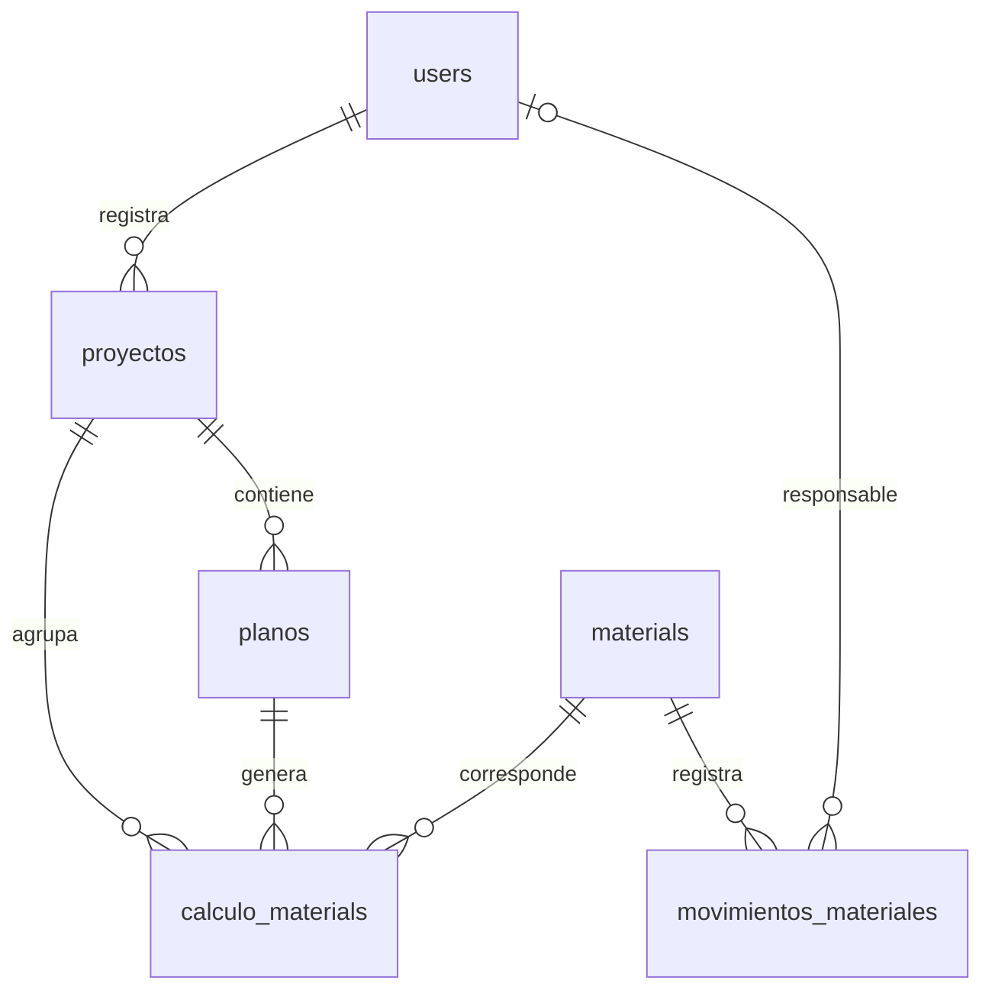
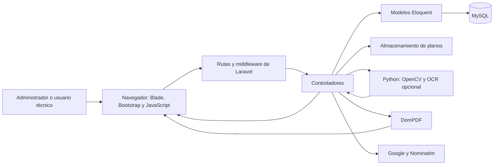

# CAPÍTULO III: INGENIERÍA DEL PROYECTO

El presente capítulo describe los requerimientos, los actores, el diseño y la arquitectura del Sistema Web para el Cálculo Automatizado de Materiales de Construcción mediante el Análisis de Planos Arquitectónicos de la Constructora ADASHA. La descripción se basa en las rutas, modelos, controladores, migraciones y pruebas existentes en el proyecto.

La aplicación permite gestionar proyectos y planos, registrar parámetros constructivos, obtener estimaciones de materiales de obra gruesa y generar reportes. Incluye funciones de autenticación, administración de usuarios y control de inventario.

El procesamiento de planos es asistido: Python y OpenCV aportan información de la imagen y, cuando está disponible el reconocimiento de texto, sugerencias extraídas de los rótulos. Las medidas reales deben ser verificadas por el usuario antes del cálculo. Los resultados constituyen estimaciones basadas en los parámetros y supuestos implementados.

Para organizar la documentación del desarrollo se propone una planificación iterativa inspirada en Scrum. La distribución en sprints presentada en este capítulo es una propuesta adaptada al alcance de ADASHA; no constituye evidencia de fechas, reuniones o entregas efectivamente realizadas.

## 3.1 REQUERIMIENTOS GENERALES DEL SISTEMA

### 3.1.1 Requerimientos funcionales generales

| Código | Requerimiento | Descripción |
|---|---|---|
| RF-01 | Inicio y cierre de sesión | Permitir el acceso mediante correo y contraseña, regenerar la sesión al ingresar y finalizarla mediante cierre de sesión. |
| RF-02 | Acceso mediante Google | Permitir autenticación mediante Google cuando las credenciales y el servicio estén configurados. |
| RF-03 | Recuperación de contraseña | Permitir solicitar y utilizar un enlace de restablecimiento para cuentas locales, sujeto a la configuración del envío de correo. |
| RF-04 | Gestión de usuarios | Permitir al administrador registrar, consultar, editar y eliminar cuentas, considerando las restricciones y los registros asociados. |
| RF-05 | Control de acceso | Diferenciar los roles `admin` y `usuario`; restringir funciones administrativas y acceso a proyectos, archivos y resultados ajenos. |
| RF-06 | Gestión de proyectos | Registrar, consultar, modificar y eliminar proyectos conforme a los permisos establecidos. |
| RF-07 | Información constructiva | Registrar cliente, ubicación, fechas, descripción y dimensiones de muros y ladrillos utilizadas en el cálculo. |
| RF-08 | Ubicación del proyecto | Registrar ubicación y coordenadas, con apoyo de un mapa y búsqueda geográfica cuando el servicio esté disponible. |
| RF-09 | Carga de planos | Adjuntar imágenes JPG, JPEG o PNG a proyectos autorizados, con un tamaño máximo configurado de 5120 KB por archivo. |
| RF-10 | Análisis asistido | Ejecutar el proceso Python para obtener información de la imagen y posibles sugerencias procedentes de rótulos. |
| RF-11 | Configuración del cálculo | Solicitar una longitud real verificada y parámetros como plantas, vanos, superficie, cubierta y componentes constructivos. |
| RF-12 | Cálculo de materiales | Estimar cantidades mediante las fórmulas implementadas y los parámetros confirmados por el usuario. |
| RF-13 | Consulta de resultados | Consultar proyectos, planos y cantidades almacenadas. El recálculo reemplaza los resultados anteriores del plano; no representa un historial de versiones de cada cálculo. |
| RF-14 | Catálogo de materiales | Permitir al administrador registrar, consultar y eliminar materiales, incluyendo unidad, stock, stock mínimo, precio unitario y descripción. |
| RF-15 | Movimientos de inventario | Registrar entradas y salidas, cantidad, motivo y responsable, actualizando existencias sin permitir una salida superior al stock disponible. |
| RF-16 | Reportes | Consultar reportes y descargar archivos PDF correspondientes a planos y proyectos autorizados. |

Fuente: Elaboración propia a partir del código de ADASHA.

El almacenamiento de precios unitarios no demuestra por sí solo la existencia de un módulo de presupuestos. Este capítulo describe los reportes de materiales y no incorpora un módulo presupuestario independiente.

### 3.1.2 Requerimientos no funcionales generales

Los siguientes requisitos expresan condiciones de calidad. Su cumplimiento debe comprobarse mediante pruebas y registros de operación; no se considera demostrado únicamente por su inclusión en este documento.

| Código | Requerimiento | Condición de verificación |
|---|---|---|
| RNF-01 | Seguridad | Las operaciones protegidas deben exigir autenticación y autorización; las contraseñas deben almacenarse mediante hash y los formularios deben validar sus entradas. |
| RNF-02 | Privacidad de archivos | El acceso a planos y reportes debe limitarse al propietario y al administrador autorizado. |
| RNF-03 | Usabilidad | Los formularios deben identificar campos, unidades, errores y acciones; las sugerencias del análisis deben distinguirse de las medidas confirmadas. |
| RNF-04 | Rendimiento | Los listados y consultas deben evaluarse con un volumen de datos representativo. La paginación es una mejora requerida para listados extensos, sin afirmar que todos los listados actuales la implementan. |
| RNF-05 | Disponibilidad | El sistema debe estar accesible durante el horario de uso acordado. Deben definirse el horario y los criterios de disponibilidad con la constructora. |
| RNF-06 | Capacidad de crecimiento | Debe permitir incorporar registros y ampliar módulos manteniendo la estructura de la aplicación; su capacidad debe evaluarse según servidor y carga. |
| RNF-07 | Compatibilidad | Deben verificarse los flujos principales en navegadores modernos y distintos tamaños de pantalla. |
| RNF-08 | Mantenibilidad | El código debe separar responsabilidades y los cambios deben registrarse mediante control de versiones. |
| RNF-09 | Respaldo y recuperación | Deben definirse copias de seguridad de MySQL y de los archivos, responsables, frecuencia y procedimiento de restauración. No se ha acreditado un proceso automático de respaldo. |
| RNF-10 | Integridad | Las relaciones deben mantenerse consistentes y los movimientos de inventario deben actualizar el stock y registrar la operación de forma coordinada. |
| RNF-11 | Consistencia de unidades | Las entradas y salidas deben mostrar unidades; las medidas en píxeles no deben utilizarse como longitudes reales sin una referencia válida. |
| RNF-12 | Configuración temporal | Las fechas de la aplicación deben gestionarse con la zona `America/La_Paz`, configurada en el proyecto. |
| RNF-13 | Manejo de fallos | Los errores del análisis, autenticación externa o geocodificación deben comunicarse sin presentar una operación fallida como completada. |

Fuente: Elaboración propia.

No se establecen tiempos máximos, porcentajes de disponibilidad ni capacidades de usuarios simultáneos sin mediciones o acuerdos que los respalden.

### 3.1.3 Identificación y descripción de los actores del sistema

El sistema implementa dos roles de acceso. Arquitectos, ingenieros y otros profesionales pueden utilizar el rol de usuario técnico; su profesión no constituye un tercer rol informático.

| Actor | Rol implementado | Descripción y acciones |
|---|---|---|
| Administrador | `admin` | Gestiona usuarios, materiales e inventario; accede a proyectos, planos, cálculos y reportes conforme a los controles administrativos. |
| Usuario técnico | `usuario` | Registra y gestiona sus proyectos, carga sus planos, solicita análisis, confirma parámetros, calcula materiales y consulta sus reportes. |
| Servicio de identidad Google | Sistema externo | Participa en el flujo de autenticación cuando se elige el acceso mediante Google. |

Fuente: Elaboración propia.

El servicio de geocodificación y el sistema de correo también son dependencias externas para funciones específicas. Python y OpenCV son componentes de procesamiento, no usuarios del sistema.

### 3.1.4 Diagrama de casos de uso general

El diagrama representa las operaciones principales de los usuarios. La autenticación y la autorización son precondiciones de las funciones protegidas. No se utiliza una relación «include» con iniciar sesión para cada caso, porque el usuario puede mantener una sesión previamente abierta.

La siguiente especificación PlantUML permite generar la figura UML:



Figura: Diagrama general de casos de uso de ADASHA. Fuente: Elaboración propia a partir de las rutas y controles de acceso.

«Usuario autenticado» es una abstracción para agrupar capacidades comunes del diagrama; no es un tercer valor de `role`. El alcance de los datos del usuario técnico se limita a sus proyectos, mientras que el administrador posee acceso administrativo.

### 3.1.5 Diagrama de clases general

El diagrama resume los modelos principales y sus relaciones. Los atributos presentados son representativos, no un diccionario exhaustivo de todos los campos de las migraciones.



Figura: Diagrama general de clases de ADASHA. Fuente: Elaboración propia.

La relación de responsabilidad del movimiento es opcional en la base de datos: `user_id` admite nulos y puede quedar sin referencia si se elimina el usuario.

### 3.1.6 Diseño de base de datos general

La base de datos MySQL almacena usuarios, proyectos, metadatos de planos, materiales, cantidades calculadas y movimientos de inventario. Los archivos de planos se gestionan mediante el almacenamiento de la aplicación y se referencian mediante su ruta.

No se han identificado tablas independientes de presupuestos o reportes. Los reportes se construyen a partir de los registros de proyectos, planos y cálculos.

#### 3.1.6.1 Modelo relacional

Cada tabla principal utiliza una clave primaria `id`. Las claves foráneas relacionan los proyectos con sus usuarios, los planos con sus proyectos, los cálculos con proyectos, planos y materiales, y los movimientos con materiales y usuarios.



Figura: Relaciones principales de la base de datos de ADASHA. Fuente: Elaboración propia.

| Tabla | Clave primaria | Claves foráneas principales |
|---|---|---|
| users | id | No aplica a las entidades principales. |
| proyectos | id | user_id → users.id |
| planos | id | proyecto_id → proyectos.id |
| materials | id | No aplica a las entidades principales. |
| calculo_materials | id | proyecto_id → proyectos.id; plano_id → planos.id; material_id → materials.id |
| movimientos_materiales | id | material_id → materials.id; user_id → users.id, nullable |

Las eliminaciones en cascada existentes deben considerarse al documentar la conservación del historial. El sistema no debe describirse como un registro inmutable de todas las operaciones y versiones.

#### 3.1.6.2 Nivel de normalización

La separación de entidades busca reducir duplicaciones. No obstante, el esquema actual no debe presentarse como completamente normalizado hasta 3FN sin analizar sus dependencias funcionales.

- **Primera Forma Normal:** Se revisa que los atributos representen valores individuales y que no existan grupos repetitivos. El campo JSON `datos_extraidos` almacena información semiestructurada; su contenido requiere un análisis específico y no demuestra normalización de sus datos internos.
- **Segunda Forma Normal:** Se revisa que los atributos no primos no dependan de una parte de una clave candidata compuesta. La existencia de un identificador simple `id` no sustituye el análisis de todas las claves candidatas.
- **Tercera Forma Normal:** Se revisan las dependencias transitivas. Los datos descriptivos de materiales se mantienen en `materials`, pero `calculo_materials` almacena tanto `plano_id` como `proyecto_id`, aunque cada plano ya identifica su proyecto. Esta duplicación puede introducir una dependencia transitiva y exige controles de consistencia o una revisión del diseño.

También debe considerarse que `stock` es un saldo almacenado y que `estado` puede relacionarse con fechas y reglas de la aplicación. Estos campos requieren controles coherentes con sus reglas de actualización.

Por tanto, el diseño tiene una organización relacional orientada a la integridad, con aspectos que deben evaluarse antes de afirmar el cumplimiento global de la tercera forma normal.

#### 3.1.6.3 Estructura general de la base de datos

Las tablas se agrupan en infraestructura de Laravel y funcionalidades propias de ADASHA. La lista corresponde a las migraciones disponibles; su presencia en una instalación concreta depende de las migraciones ejecutadas.

No se incluye un apartado de tablas de Spatie, porque ese paquete no aparece entre las dependencias revisadas. El control de roles utiliza `users.role` y middleware propio. Una migración antigua agrega `rol`, pero el código de autorización actual consulta `role`.

##### 3.1.6.3.1 Tablas de origen Laravel

| Tabla | Función |
|---|---|
| users | Cuentas y credenciales; ampliada con rol, identificador de Google y avatar. |
| migrations | Registro de migraciones ejecutadas. |
| password_reset_tokens | Datos temporales del restablecimiento de contraseñas. |
| sessions | Persistencia de sesiones cuando se configura el controlador de base de datos. |
| cache y cache_locks | Persistencia de caché y bloqueos cuando se utiliza ese almacenamiento. |
| jobs, job_batches y failed_jobs | Infraestructura para colas, lotes y fallos cuando esas funciones se utilizan. |

##### 3.1.6.3.2 Tablas creadas para las funcionalidades del proyecto

| Tabla | Información principal |
|---|---|
| proyectos | Nombre, cliente, propietario, ubicación, coordenadas, fechas, descripción y parámetros de muros y ladrillos. |
| planos | Proyecto, nombre, archivo, ruta, tipo, estado de procesamiento, datos extraídos y configuración de cálculo. |
| materials | Nombre, unidad, descripción, stock, stock mínimo y precio unitario. |
| calculo_materials | Proyecto, plano, material y cantidad estimada. |
| movimientos_materiales | Material, responsable opcional, tipo de movimiento, cantidad, motivo y fechas. |

Fuente de las tablas: Elaboración propia a partir de modelos y migraciones.

### 3.1.7 Arquitectura del sistema

ADASHA utiliza una arquitectura web con Laravel y organización MVC. Integra MySQL, almacenamiento de archivos, un proceso Python y servicios externos para funciones específicas. Los siguientes apartados describen responsabilidades lógicas; no implican que cada una se ejecute en un servidor separado.



Figura: Arquitectura general de ADASHA. Fuente: Elaboración propia.

#### 3.1.7.1 Capa de presentación — Vista

La interfaz se construye mediante Blade, HTML, CSS, JavaScript y Bootstrap. Incluye acceso, panel principal, gestión de proyectos, carga de planos, configuración de cálculos, resultados, reportes, usuarios y materiales.

Sus responsabilidades son presentar información, recoger entradas, mostrar validaciones y facilitar la navegación. Leaflet se utiliza para visualizar mapas vinculados con la ubicación del proyecto. Los permisos deben comprobarse en el servidor aunque la interfaz oculte una opción.

#### 3.1.7.2 Capa de lógica del sistema — Controlador

| Componente | Responsabilidad |
|---|---|
| UsuarioController | Registro, consulta, edición y eliminación de usuarios. |
| ProyectoController | Gestión de proyectos, historial de clientes y geocodificación. |
| PlanoController | Gestión y acceso autorizado a archivos; coordinación del proceso Python. |
| CalculoMaterialController | Configuración, validación y ejecución de cálculos; consulta de resultados y reportes relacionados. |
| ReporteController | Consulta y descarga de reportes autorizados. |
| MaterialController | Registro y eliminación de materiales; entradas y salidas de inventario. |
| GoogleAuthController | Flujo de autenticación mediante Google. |
| PasswordResetController | Solicitud y actualización de contraseñas. |
| DashboardController | Preparación de información del panel principal según el usuario. |

El acceso local y el cierre de sesión también tienen lógica definida directamente en `routes/web.php`.

Los movimientos de inventario utilizan una transacción y bloqueo del registro del material. Se valida que el saldo resultante no sea negativo antes de actualizar el stock y registrar el movimiento.

#### 3.1.7.3 Capa de acceso a datos — Modelo

Los modelos Eloquent representan las entidades y permiten recuperar y modificar sus registros. Sus relaciones conectan proyectos, planos, cálculos, materiales y movimientos.

Las migraciones describen la evolución del esquema. Las restricciones de MySQL y las validaciones de Laravel contribuyen conjuntamente a la integridad. El ORM no reemplaza las verificaciones de permisos, pertenencia de registros ni reglas del negocio.

#### 3.1.7.4 Componentes de procesamiento e integraciones externas

| Componente | Clasificación | Función |
|---|---|---|
| Google y Laravel Socialite | Servicio externo y paquete de integración | Autenticación con un proveedor de identidad. |
| Nominatim | Servicio externo | Búsqueda de ubicaciones y coordenadas. |
| Leaflet | Biblioteca de interfaz | Visualización e interacción con mapas. |
| Python y OpenCV | Procesamiento ejecutado desde la aplicación | Análisis de imágenes y contornos. |
| pytesseract y Tesseract | Integración opcional de OCR | Lectura de texto y rótulos cuando están disponibles. |
| DomPDF | Biblioteca | Generación de documentos PDF. |
| Servicio de correo configurado | Infraestructura | Envío de enlaces de recuperación de contraseña. |

No todos estos componentes son servicios externos: Leaflet y DomPDF son bibliotecas y Python es un proceso de apoyo. Los errores de cada integración deben comunicarse al usuario y considerarse en las pruebas.

#### 3.1.7.5 Comunicación entre capas

1. El usuario realiza una acción en la interfaz.
2. El navegador envía una solicitud HTTP a Laravel.
3. Los middleware comprueban autenticación y rol.
4. El controlador valida datos y autorización sobre los registros.
5. Los modelos consultan o modifican MySQL; los archivos se gestionan mediante almacenamiento.
6. Si corresponde, se ejecuta Python, una consulta externa o la generación del PDF.
7. El servidor devuelve una vista, redirección, respuesta de datos o documento.
8. La interfaz presenta el resultado o los errores.

En el cálculo, una medida sugerida por OCR se presenta para revisión. El usuario confirma los valores reales antes de guardar la configuración y ejecutar las fórmulas. Analizar una imagen no equivale a aprobar sus dimensiones.

## 3.2 ORGANIZACIÓN ITERATIVA DEL DESARROLLO INSPIRADA EN SCRUM

Scrum es un marco de trabajo con responsabilidades de Product Owner, Scrum Master y Developers. Su organización utiliza Product Backlog, Sprint Backlog e Incremento, y eventos de planificación, seguimiento, revisión y retrospectiva. Estos elementos se describen en la [Guía de Scrum de Schwaber y Sutherland (2020)](https://scrumguides.org/docs/scrumguide/v2020/2020-Scrum-Guide-Spanish-Latin-South-American.pdf).

Para ADASHA se presenta una propuesta académica de organización. Si no existen registros de participantes, eventos y entregas, debe describirse como una adaptación inspirada en Scrum y no como evidencia de aplicación completa del marco.

### 3.2.1 Responsabilidades y participantes

| Responsabilidad | Asignación propuesta para el proyecto |
|---|---|
| Product Owner | Persona designada para priorizar las necesidades de la constructora y aclarar los requisitos. Su identidad debe documentarse con la participación real. |
| Scrum Master | Persona encargada de facilitar el proceso y ayudar a resolver dificultades de organización. No se atribuye automáticamente esta responsabilidad al tutor. |
| Developers | Personas que realizan diseño, implementación, integración y pruebas. Si el desarrollo es individual, debe indicarse esa condición. |
| Interesados | Personal de ADASHA y participantes académicos que aporten observaciones, sin asumir que ocupan una responsabilidad formal del equipo. |

### 3.2.2 Planificación y gestión de sprints

La propuesta distribuye el alcance en cuatro iteraciones. Las fechas, duración y dedicación deben registrarse conforme al cronograma real; no se deducen del orden de las migraciones.

Cada iteración necesita un objetivo, historias seleccionadas, tareas, criterios de aceptación y evidencias. El seguimiento puede registrarse en una hoja de trabajo o herramienta utilizada efectivamente por el proyecto, sin afirmar el uso de Trello si no está documentado.

### 3.2.3 Product Backlog

El backlog propuesto reúne historias derivadas de las funcionalidades existentes. Las prioridades expresan una secuencia de trabajo sugerida, no una validación formal de la constructora.

| Historia | Como… quiero… para… | Prioridad | Criterio de aceptación principal | Sprint |
|---|---|---|---|---|
| HU-01 | Usuario, iniciar y cerrar sesión para acceder de manera controlada. | Alta | Credenciales válidas permiten entrar; inválidas no; salir invalida la sesión. | 1 |
| HU-02 | Usuario, acceder con Google para utilizar mi cuenta externa. | Media | El flujo configurado valida la respuesta del proveedor. | 1 |
| HU-03 | Usuario, recuperar mi contraseña para restablecer el acceso. | Alta | Un token válido permite cambiar la contraseña; uno inválido no. | 1 |
| HU-04 | Administrador, gestionar usuarios para mantener las cuentas. | Alta | Solo el administrador accede a la gestión y se valida correo y rol. | 1 |
| HU-05 | Usuario técnico, gestionar proyectos para organizar obras. | Alta | Puede trabajar con sus proyectos y no modificar los de otro usuario. | 2 |
| HU-06 | Usuario técnico, registrar datos constructivos y ubicación para configurar la obra. | Alta | Dimensiones, fechas y coordenadas se validan conforme al formulario. | 2 |
| HU-07 | Usuario técnico, cargar planos para asociarlos con el proyecto. | Alta | Solo se admiten imágenes autorizadas y archivos dentro del límite. | 2 |
| HU-08 | Usuario técnico, analizar la imagen para obtener información de apoyo. | Alta | Se procesa el resultado o se comunica el error; las sugerencias no se guardan como medidas confirmadas. | 3 |
| HU-09 | Usuario técnico, confirmar parámetros para calcular con medidas verificadas. | Alta | Se exige longitud positiva y se rechazan vanos incompatibles. | 3 |
| HU-10 | Usuario técnico, calcular materiales para consultar cantidades estimadas. | Alta | Los resultados corresponden a parámetros y fórmulas documentados. | 3 |
| HU-11 | Usuario técnico, consultar resultados y reportes para revisar la obra. | Alta | La información mostrada pertenece al proyecto autorizado. | 4 |
| HU-12 | Usuario técnico, descargar un PDF para compartir el reporte. | Media | El PDF contiene los datos y unidades correspondientes al plano. | 4 |
| HU-13 | Administrador, registrar materiales para mantener el catálogo. | Alta | Se registran campos válidos y cantidades no negativas. | 4 |
| HU-14 | Administrador, registrar movimientos para controlar existencias. | Alta | La entrada suma stock y la salida no supera las existencias. | 4 |

Fuente: Elaboración propia.

### 3.2.4 Planificación de sprints

| Sprint | Objetivo | Incremento esperado |
|---|---|---|
| 1 | Controlar el acceso y administrar cuentas. | Autenticación y gestión de usuarios integradas. |
| 2 | Organizar proyectos y almacenar sus planos. | Proyectos, parámetros y archivos accesibles según permisos. |
| 3 | Obtener estimaciones mediante análisis asistido y medidas confirmadas. | Flujo de análisis, configuración y cálculo integrado. |
| 4 | Consultar reportes y controlar materiales e inventario. | Reportes PDF, catálogo y movimientos integrados. |

Esta secuencia organiza el capítulo y puede ajustarse al historial real del desarrollo. El cuarto sprint reúne varios módulos; su alcance debe reducirse o dividirse si no cabe en la capacidad acordada.

### 3.2.5 Criterios comunes de finalización

Para considerar una historia finalizada en esta propuesta se requiere que sus criterios de aceptación estén verificados, las entradas y permisos estén controlados, el cambio esté integrado y exista evidencia de las pruebas pertinentes. Las incidencias pendientes deben identificarse, y los resultados no deben marcarse como aprobados sin ejecución.

### 3.2.6 Implementación por sprints

Las siguientes fichas relacionan los módulos existentes con una organización propuesta. Describen tareas y pruebas que deben respaldarse mediante evidencias; no acreditan que se hayan ejecutado durante sprints históricos.

#### 3.2.6.1 Sprint 1: Autenticación y gestión de usuarios

**Objetivo del sprint.** Permitir el acceso controlado y la administración de cuentas según los roles implementados.

**Sprint Backlog**

| Historia | Tareas principales | Entregable |
|---|---|---|
| HU-01 | Integrar acceso local, regeneración de sesión, cierre y límite de intentos. | Flujo de inicio y cierre de sesión. |
| HU-02 | Configurar Socialite y verificar el retorno de Google. | Acceso externo sujeto a configuración. |
| HU-03 | Integrar solicitud de enlace, token y cambio de contraseña. | Recuperación de cuenta local. |
| HU-04 | Integrar formularios de usuarios, validaciones y middleware de rol. | Gestión administrativa de cuentas. |

**Diseño y arquitectura.** Participan `User`, `UsuarioController`, `GoogleAuthController`, `PasswordResetController`, las rutas de autenticación y el middleware de roles. El campo utilizado es `role`, con valores `admin` y `usuario`. Las contraseñas se almacenan mediante hash.

**Diseño e implementación de interfaces.** Se utilizan las pantallas de acceso, recuperación y restablecimiento, y las vistas de listado, registro y edición de usuarios. Los mensajes deben distinguir datos inválidos, acceso denegado y fallos de configuración externa.

**Pruebas**

| Caso | Acción | Resultado esperado |
|---|---|---|
| CP-01 | Ingresar con credenciales válidas e inválidas. | Acceso solo con credenciales válidas. |
| CP-02 | Cerrar sesión y solicitar una ruta protegida. | Se requiere autenticación nuevamente. |
| CP-03 | Solicitar gestión de usuarios con rol `usuario`. | Acceso denegado. |
| CP-04 | Registrar un correo duplicado o un rol no admitido. | Error de validación sin creación inválida. |
| CP-05 | Realizar intentos repetidos de acceso fallido. | Se aplica el límite configurado. |
| CP-06 | Usar tokens de recuperación válidos e inválidos. | Cambio permitido únicamente con token válido. |
| CP-07 | Probar Google en entorno configurado y retorno sin estado válido. | Autenticación válida o rechazo del retorno inválido. |

Existe una prueba automatizada para limitación de intentos y otra para retorno de Google sin estado. La aprobación del sprint requiere resultados de ejecución y verificaciones del resto de los casos.

#### 3.2.6.2 Sprint 2: Gestión de proyectos y planos arquitectónicos

**Objetivo del sprint.** Permitir registrar obras, definir sus parámetros y asociar imágenes de planos con acceso autorizado.

**Sprint Backlog**

| Historia | Tareas principales | Entregable |
|---|---|---|
| HU-05 | Integrar registro, edición, consulta, eliminación y controles de propiedad. | Gestión de proyectos. |
| HU-06 | Integrar cliente, ubicación, fechas y dimensiones; mapa y geocodificación. | Información constructiva del proyecto. |
| HU-07 | Validar archivos, almacenarlos y restringir su consulta y eliminación. | Planos asociados al proyecto. |

**Diseño y arquitectura.** Participan `Proyecto`, `Plano`, `ProyectoController` y `PlanoController`. La clave `user_id` identifica al propietario y `proyecto_id` vincula el plano. Leaflet presenta el mapa; Nominatim apoya la búsqueda de ubicación. El archivo se almacena separado de sus metadatos.

**Diseño e implementación de interfaces.** Se utilizan listados y formularios de proyectos, campos de dimensiones y fechas, mapa y controles de carga y consulta de planos. Los campos deben indicar metros u otras unidades correspondientes y el límite de archivo. La implementación admite JPG, JPEG y PNG; no debe documentarse carga de PDF, DWG o DXF como función actual.

**Pruebas**

| Caso | Acción | Resultado esperado |
|---|---|---|
| CP-08 | Registrar y modificar un proyecto con datos válidos. | Información asociada al propietario correcto. |
| CP-09 | Intentar acceder al proyecto o archivo de otro usuario. | Operación denegada para el usuario no autorizado. |
| CP-10 | Cargar una imagen admitida dentro del límite. | Archivo y metadatos asociados al proyecto. |
| CP-11 | Cargar PDF o archivo mayor a 5120 KB. | Rechazo mediante validación. |
| CP-12 | Registrar dimensiones o fechas inválidas. | Errores de validación sin guardado inconsistente. |
| CP-13 | Simular indisponibilidad de geocodificación. | Mensaje comprensible y conservación de los demás datos del formulario. |
| CP-14 | Consultar estados calculados según fechas. | Estado correspondiente a las reglas implementadas. |

Existen pruebas de acceso a archivos, rechazo de PDF y estados de proyectos. La eliminación debe verificarse considerando registros y archivos asociados.

#### 3.2.6.3 Sprint 3: Análisis asistido de planos y cálculo de materiales

**Objetivo del sprint.** Integrar el procesamiento de imágenes con una configuración verificada para obtener cantidades referenciales de materiales.

**Sprint Backlog**

| Historia | Tareas principales | Entregable |
|---|---|---|
| HU-08 | Ejecutar Python, validar JSON y mostrar detecciones y sugerencias. | Análisis asistido y comunicación de errores. |
| HU-09 | Confirmar longitud por planta, plantas, vanos, superficie y componentes constructivos. | Parámetros validados. |
| HU-10 | Ejecutar fórmulas, asociar materiales y almacenar resultados. | Cantidades consultables por plano. |

**Diseño y arquitectura.** `PlanoController` coordina `python/analizar_plano.py`. OpenCV procesa la imagen; OCR opcional permite interpretar rótulos mediante `medidas_rotuladas.py`. `CalculoMaterialController` solicita valores confirmados y registra resultados en `calculo_materials`.

**Proceso de cálculo.** Para los muros, la implementación calcula:

```text
Área bruta de muros = longitud por planta × altura de muro × número de plantas
Área neta de muros = área bruta − área total de vanos
Volumen de muros = área neta × espesor
Área del módulo de ladrillo = (largo + 0,01 m) × (alto + 0,01 m)
Ladrillos sin desperdicio = área neta / área del módulo
Ladrillos estimados para compra = ladrillos sin desperdicio × 1,10
```

El código estima el mortero a partir del volumen restante y aplica coeficientes para cemento y arena. Según la configuración, también incluye cimentación, columnas, vigas y cubierta, con materiales como grava, piedra, fierro, alambre, madera, clavos y agua.

Estas fórmulas y coeficientes describen el algoritmo implementado; no se presentan como parámetros universales ni como validación estructural. La longitud solicitada corresponde a una planta y el área de vanos debe utilizar el alcance total compatible con la multiplicación por plantas.

**Diseño e implementación de interfaces.** La configuración muestra sugerencias OCR como valores revisables y permite confirmar longitud, cantidad de plantas, área de vanos, superficie y opciones constructivas. Las sugerencias no deben guardarse automáticamente como una medición aprobada.

**Pruebas**

| Caso | Acción | Resultado esperado |
|---|---|---|
| CP-15 | Analizar una imagen válida o una ilegible. | Resultado estructurado o mensaje de fallo. |
| CP-16 | Analizar un plano sin OCR disponible. | No se inventan medidas reales; se solicita confirmación manual. |
| CP-17 | Interpretar un rótulo con dimensiones. | Sugerencias revisables, sin confirmación automática. |
| CP-18 | Calcular sin longitud real positiva. | Solicitud rechazada. |
| CP-19 | Introducir vanos superiores al área bruta. | Error sin modificar la configuración anterior. |
| CP-20 | Comparar un ejemplo calculado manualmente con el sistema. | Coincidencia dentro de la tolerancia definida para redondeos. |
| CP-21 | Comparar una y dos plantas y tipos de cubierta. | Aplicación correcta de los parámetros implementados. |
| CP-22 | Provocar un fallo durante el recálculo. | Conservación de información anterior conforme a la protección implementada. |

Existen pruebas para longitud real, vanos inválidos, ejemplos con dos plantas, sugerencias OCR y conservación de datos ante un fallo. Además hay pruebas Python de extracción de medidas rotuladas. Se requieren registros de ejecución y comparación con casos de referencia.

El recálculo elimina y sustituye las cantidades anteriores del plano. El sistema no debe presentarse como un historial de todas las versiones de cálculo.

#### 3.2.6.4 Sprint 4: Reportes, catálogo de materiales y control de inventario

**Objetivo del sprint.** Presentar resultados autorizados y administrar existencias mediante movimientos registrados.

**Sprint Backlog**

| Historia | Tareas principales | Entregable |
|---|---|---|
| HU-11 | Consultar resultados y verificar pertenencia del plano. | Reportes accesibles según permisos. |
| HU-12 | Generar y descargar PDF mediante DomPDF. | Documento de cantidades y unidades. |
| HU-13 | Registrar y consultar materiales y sus datos. | Catálogo administrativo. |
| HU-14 | Registrar entradas y salidas con transacción y control de saldo. | Inventario actualizado y movimientos trazables. |

**Diseño y arquitectura.** Participan `ReporteController`, las funciones de reporte de `CalculoMaterialController`, DomPDF, `MaterialController`, `Material` y `MovimientoMaterial`. Los reportes utilizan datos existentes y no requieren una entidad de reporte independiente. Los cálculos de demanda y los movimientos de stock son operaciones distintas: calcular materiales no equivale a registrar una salida de inventario.

**Diseño e implementación de interfaces.** Se utilizan las pantallas de resultados y reportes, el catálogo y los formularios de entrada y salida. Deben presentarse nombre, unidad, cantidad y motivo, junto con mensajes de validación. Los reportes deben identificar proyecto y plano.

**Pruebas**

| Caso | Acción | Resultado esperado |
|---|---|---|
| CP-23 | Consultar o descargar un reporte de otro usuario. | Acceso denegado. |
| CP-24 | Descargar un reporte con resultados. | PDF correspondiente al proyecto y plano seleccionados. |
| CP-25 | Solicitar reporte sin resultados. | Mensaje de ausencia de datos. |
| CP-26 | Registrar material con stock o precio negativo. | Rechazo mediante validación. |
| CP-27 | Registrar entrada de 5 unidades sobre stock de 10. | Saldo de 15 y movimiento asociado al responsable. |
| CP-28 | Registrar salida de 3 unidades sobre stock de 10. | Saldo de 7 y movimiento registrado. |
| CP-29 | Registrar salida de 11 unidades sobre stock de 10. | Rechazo y saldo sin cambios. |
| CP-30 | Probar movimientos concurrentes sobre el mismo material. | Consistencia del saldo y de los movimientos. |
| CP-31 | Calcular cantidades sin registrar un movimiento. | El stock no se descuenta automáticamente por el cálculo. |

Existe una prueba automatizada para acceso a reportes ajenos. Los demás casos requieren su correspondiente evidencia antes de declarar el incremento aprobado.

### 3.2.7 Registro de ejecución de pruebas

El proyecto contiene archivos de pruebas automatizadas, pero esta revisión documental no las ejecutó. Los casos anteriores son criterios y escenarios; no son resultados aprobados.

Se propone registrar la ejecución mediante la siguiente plantilla:

| Caso | Fecha y responsable | Entorno y datos | Resultado obtenido | Estado | Evidencia o incidencia |
|---|---|---|---|---|---|
| CP-XX | Por registrar | Por registrar | Por registrar | No ejecutado | Por registrar |

### 3.2.8 Revisión de incrementos y mejora del proceso

Al revisar un incremento deben documentarse las funciones demostradas, las observaciones recibidas y los cambios pendientes. La mejora del proceso debe registrar dificultades concretas y acciones para la siguiente iteración.

Si estas actividades ya se realizaron, se deben incorporar fechas, participantes y evidencias reales. Si todavía no se realizaron, permanecerán como parte de la planificación propuesta.

## Notas para cerrar la versión académica

- Incorporar nombres y participación real de los responsables, así como fechas y duración de las iteraciones.
- Convertir la especificación PlantUML y los diagramas Mermaid en figuras según el formato exigido por la institución, conservando sus títulos y fuentes.
- Añadir capturas de las interfaces utilizadas en cada sprint.
- Completar resultados y evidencias de pruebas; no cambiar «No ejecutado» por «Aprobado» sin verificación.
- Documentar el horario de servicio, criterios de rendimiento y procedimiento de respaldo acordados.
- Verificar el esquema de la instalación real antes de presentar un diccionario completo o afirmar el cumplimiento de 3FN.

La revisión del código también encontró que el método `down()` de la migración `2026_08_04_165445_create_calculo_materials_table.php` vuelve a crear la tabla después de eliminarla. Debe revisarse antes de documentar la reversión de migraciones como correcta. Esta tarea no modifica ese código.

